# Railtime: the interface, for a redesign

Railtime is a map of a city's metro that you can explore as it is today, as it was on any day
since it opened, or as it could be in a plan, and a player that builds it up on the map, one
opening at a time.

This document covers **the interface around the map**: pages, panels, bars, menus and captions,
built in Nuxt 4 with [Nuxt UI 4](https://ui.nuxt.com) and Tailwind. It does not cover the map
drawing itself: the lines, station dots, labels and animations come from the map engine, and are
out of scope here.

Screenshots are in `screens/`, taken at 1440×900 (desktop) and 390×844 (phone).

## What the product does

- **Explore:** pick a city; the map shows its network today. Drag the year slider to see it on any
  past date; click a station for its lines and history.
- **History:** _Play history_ grows the network from its first line, change by change, with the
  camera following and a caption for each change.
- **Plans:** a city can have plans for its future (or, for a city whose metro was never built, only
  plans). Choosing one shows the network as it would be, the unbuilt part dashed; _Play future_
  builds it section by section.

## Current design system

- Nuxt UI 4 components: `UCard`, `UButton`, `USelect`, `USlider`, `UPopover`, `UBadge`,
  `UPageCard`, `UPageGrid`, `UColorModeButton`, `UTooltip`.
- Colours: `primary: sky`, `neutral: zinc` (`web/app/app.config.ts`). Panels over the map are
  translucent (`bg-default/85` with `backdrop-blur`).
- Light and dark themes; the map's basemap and line colours follow the theme.
- Line colours come from the data (each city's official colours), not from the design system.
- Font: Nuxt UI's default (system / Inter-like). Map labels use the basemap's own font.

## Screens

### 1. Landing page: `/`

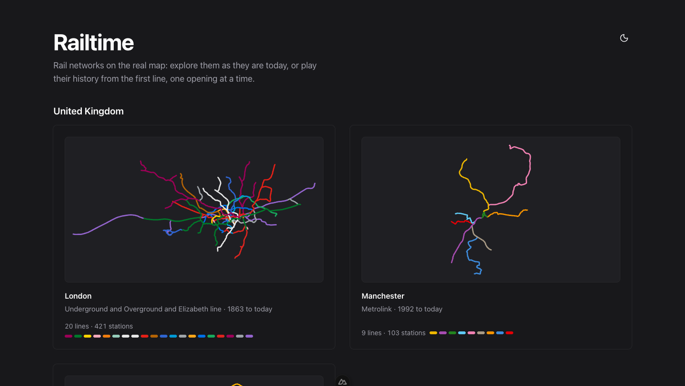
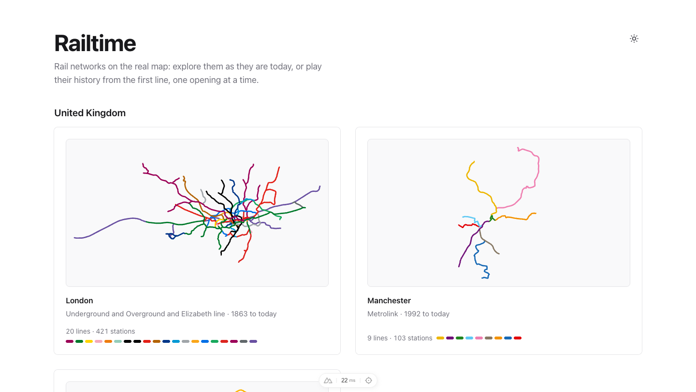

`web/app/pages/index.vue`, `components/cities/CityCard.vue`, `CityPreview.vue`

- Title, one-line pitch, colour-mode toggle.
- Cities grouped by country (United Kingdom, Ukraine), two cards per row.
- Each card: a sketch of the network in its line colours, the city's name, its networks and years
  ("Underground and Overground and Elizabeth line · 1863 to today", or "never built"), and a footer
  with line count, station count and a swatch per line.
- The whole card links to the city.

### 2. City map, today: `/<city>`


`components/explorer/ExplorerView.vue` lays out everything over the full-screen map:

- **Top left:** a grid button back to all cities; the **city menu**; the **plan picker** (only for
  cities with plans).
- **Under them:** the **HUD** (`ExplorerHud.vue`): "Today", or the year, in large type, and a line of
  stats: stations, kilometres and lines on the map.
- **Top right:** the **lines panel** (`LinePanel.vue`).
- **Bottom centre:** the **explore bar** (`ExploreBar.vue`): _Play history_, the year, a year
  slider, _Today_ (when not on today), the colour-mode toggle.
- **Bottom right:** the map credits (OpenStreetMap; required by its licence), expandable.

### 3. City menu

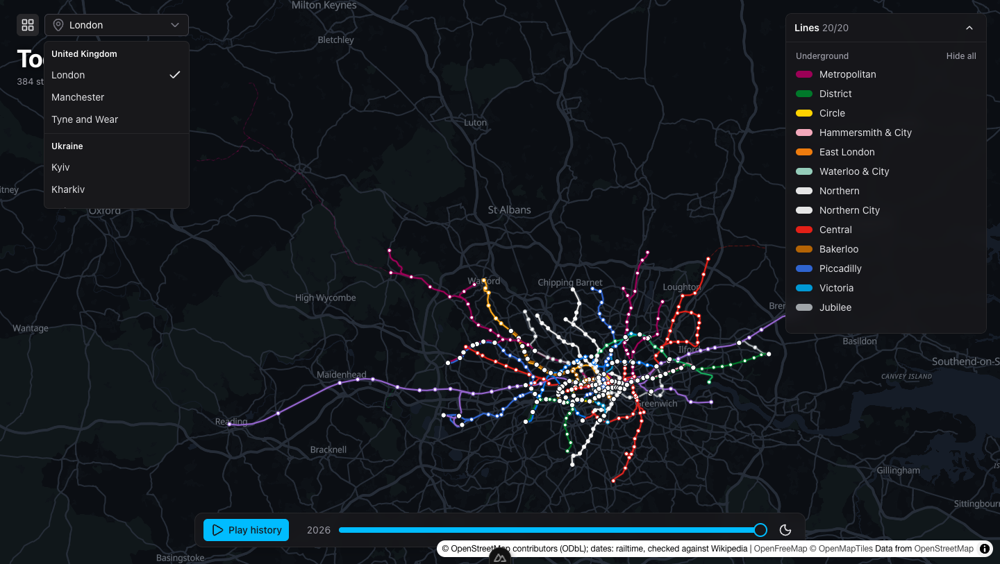

A `USelect` grouped by country, with a check on the current city.

### 4. A past date, with a station panel

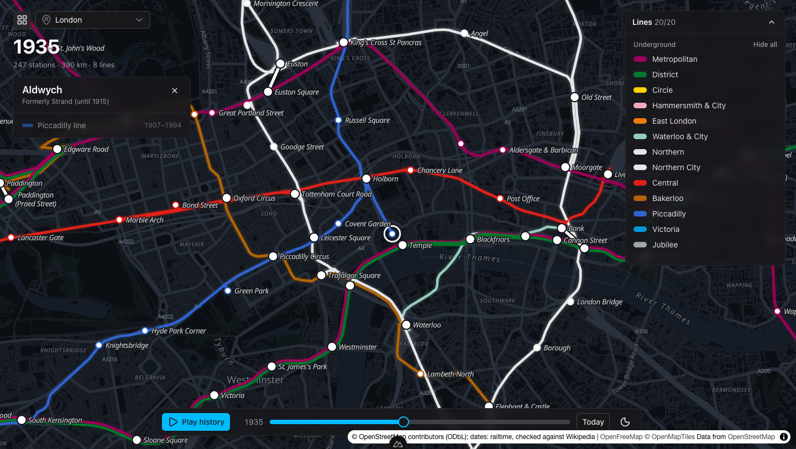

Moving the slider (or a link like `/london?date=1935-06-01&station=aldwych`) shows the network on
that day. Clicking a station opens the **station panel** (`StationPanel.vue`), under the HUD:

- its name on that date, its name in other languages (in Ukrainian cities), earlier names
  ("Formerly …");
- each line serving it, with a colour bar and "since 1907", "1907–1994" or "planned";
- **Change for**: stations a short walk away on other lines, each with its lines' colours, clickable.

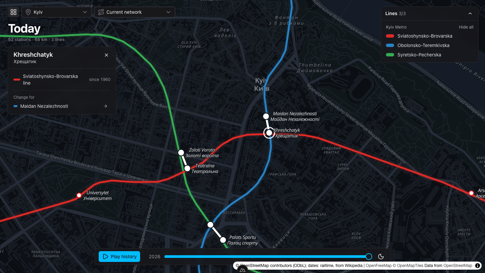

### 5. Lines panel

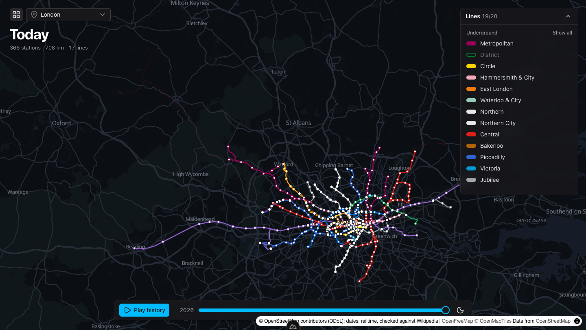

- Header "Lines 19/20" (shown/total), collapsible.
- Lines grouped by network (Underground, Overground, Elizabeth line), each group with _Show all /
  Hide all_.
- Each line is one row: a colour pill (filled when shown, hollow when hidden) and its name (dimmed
  when hidden). On hover, _Only_ shows that line alone (_All_ brings the rest back).

### 6. History playback

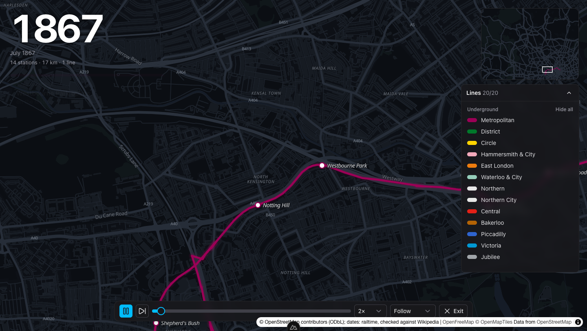

_Play history_ switches the screen to playback:

- the HUD's year grows large, with the month (or the exact day while a change plays);
- a **step card** (`StepCard.vue`) under it: a strip in the line's colour, the date, the change
  ("Metropolitan line extended"), its ends ("Edgware Road – Brompton"), and a chip per new station,
  appearing as the line reaches it;
- a **minimap** of the whole city, top right, with the camera's view outlined;
- the **playback bar** (`PlaybackBar.vue`): play/pause, next change, a timeline slider, speed
  (1×–8×), camera (Follow / Overview / Free), Exit.

### 7. Plans

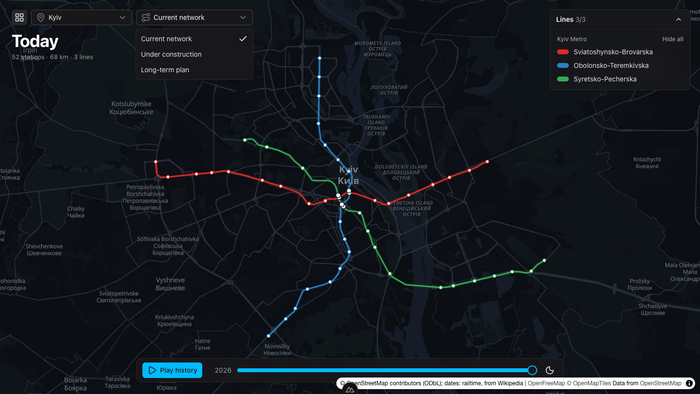

The **plan picker** offers _Current network_ and each plan the city has ("Under construction",
"Long-term plan", or for other cities "1980s underground tram", "Fan scheme" and so on).

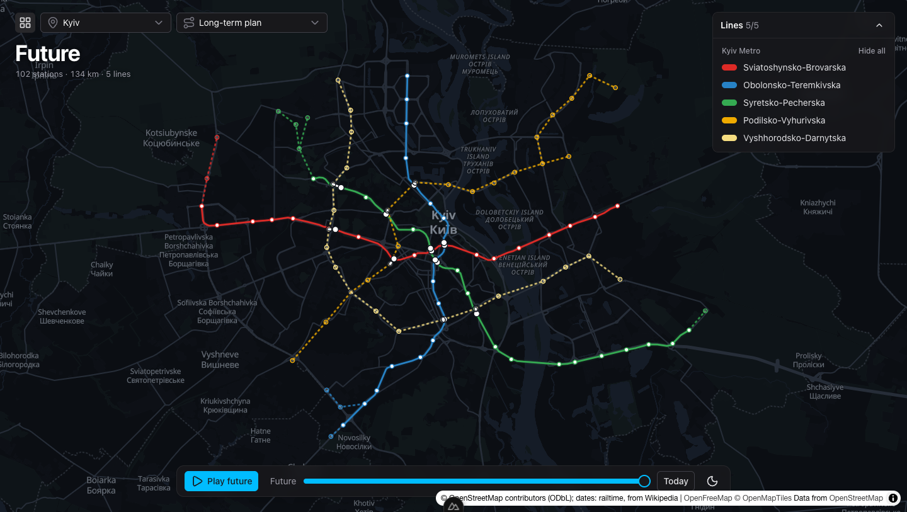

With a plan chosen the map opens on its future: the HUD reads "Future", the unbuilt track is dashed
in its line's colour, unbuilt stations are rings. The explore bar has _Play future_, _Today_ and
_Future_.

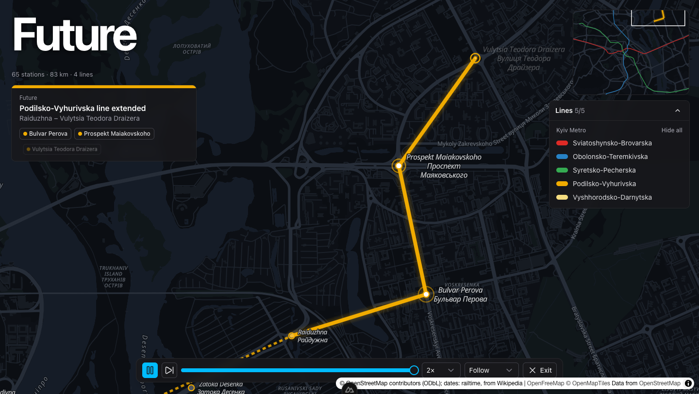

_Play future_ builds the plan from today, section by section; step cards read "Future" instead of a
date.

### 8. A city that was never built

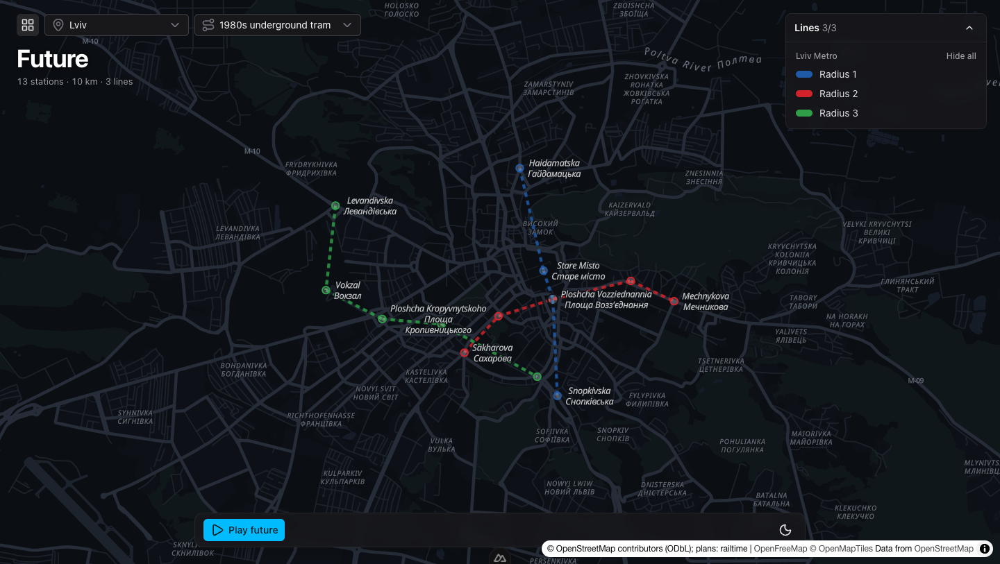

Lviv, Odesa, Zaporizhzhia and Chernivtsi never got a metro. They open straight on their first plan:
no _Current network_, no year slider, just _Play future_.

### 9. Light theme

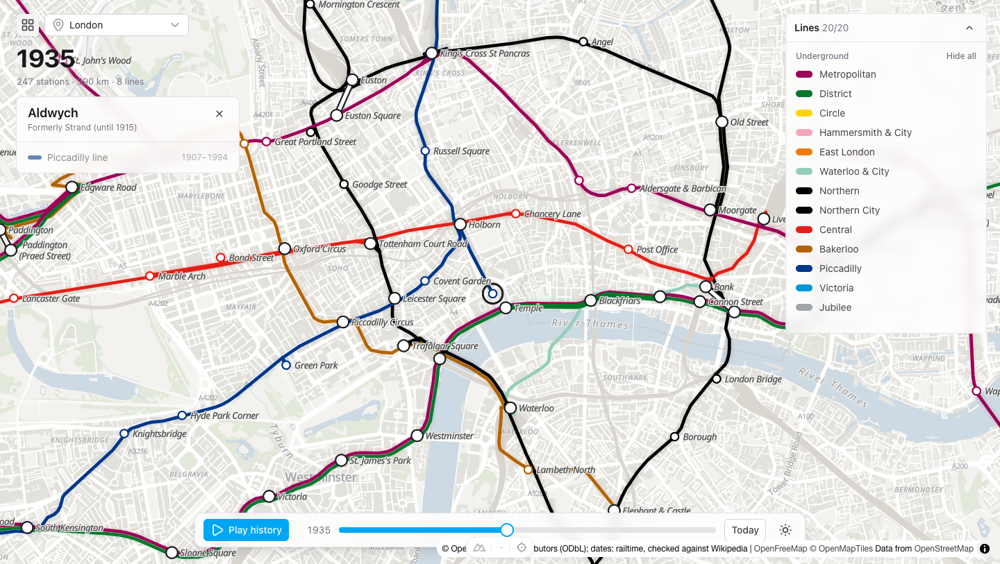

### 10. Phone

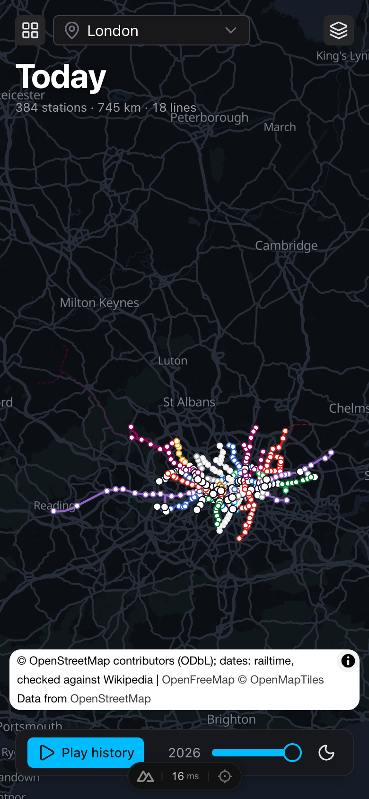
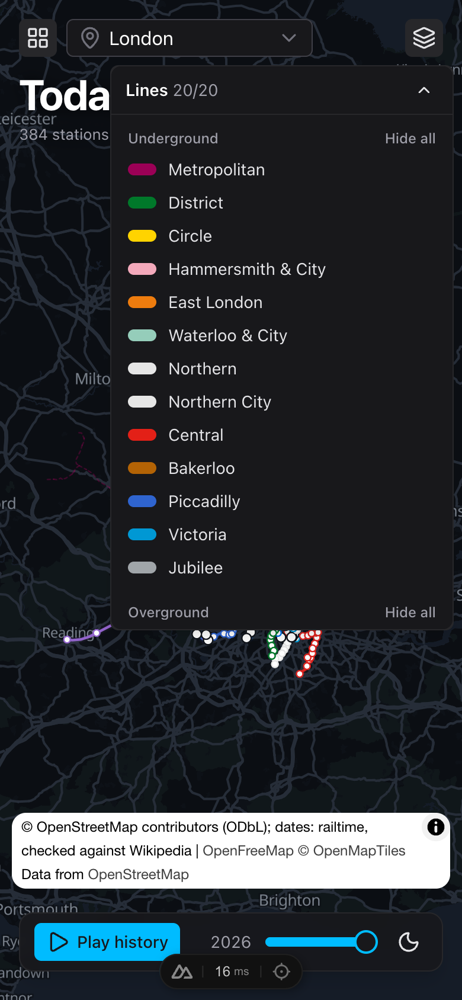
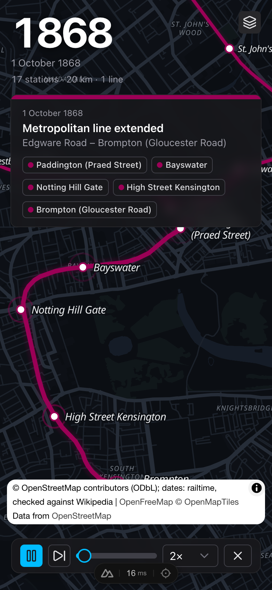
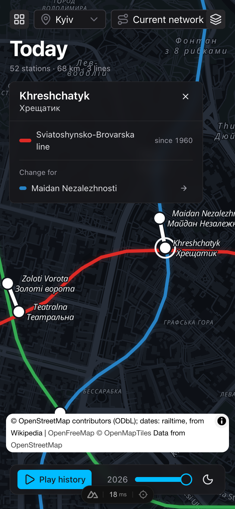

- The lines panel becomes a button (layers icon) opening it in a popover.
- The minimap is hidden; the camera menu is hidden in playback; _Exit_ is an icon.
- The map credits sit above the bottom bar.

## Where the current design falls short

Things noticed while building it, as starting points:

- **Many floating panels, no system.** HUD, step card, station panel, lines panel, minimap and two
  bars all float over the map with similar cards; nothing ties them into one layout, and on smaller
  screens they compete for the same corners.
- **The HUD's text sits directly on the map**, readable only thanks to a shadow; the large year is
  striking in playback but heavy while exploring.
- **The station panel and the step card share the left column**: one pushes the other down.
- **The explore bar mixes unlike things**: play, a time slider, _Today/Future_ and the theme toggle.
- **The slider gives no sense of history**: no marks for openings, no labels but the year.
- **Plans are a select box**: nothing explains what a plan is, how sure it is, or how it differs
  from another; a "never built" city looks like any other.
- **On a phone** the credits box covers part of the map and bar; the step card and HUD take much of
  the screen during playback; the lines popover is long for big networks.
- **The lines panel** lists 20 lines for London; for big cities it needs search, or a more compact
  form.
- **Landing cards** are all the same size whatever the network; there is no way to see at a glance
  which cities have plans or history to play.

## Running it

```bash
pnpm install
pnpm dev        # http://localhost:5180
```

Useful addresses: `/london`, `/london?date=1935-06-01&station=aldwych`, `/kyiv?plan=long-term`,
`/lviv`. Components are in `web/app/components/`; the page layout in
`web/app/components/explorer/ExplorerView.vue`.
